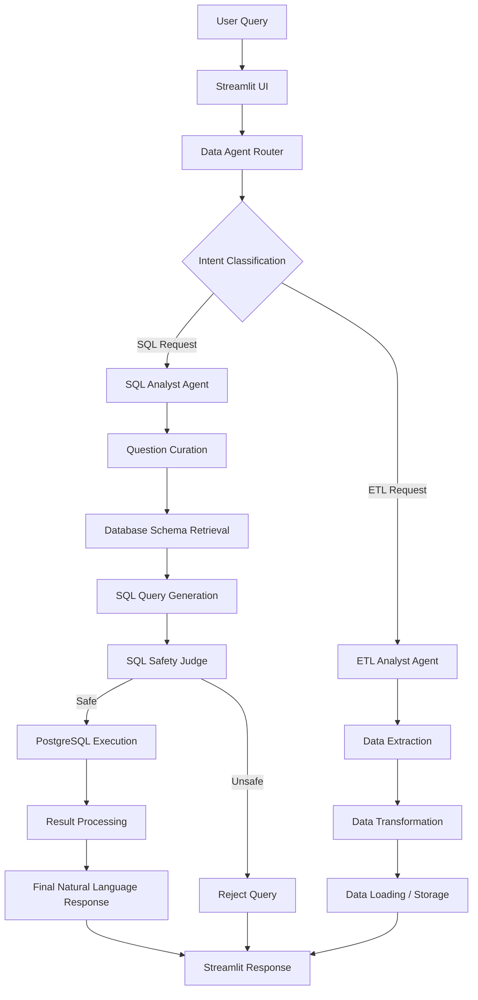

# 🤖 AI Data Agent – Intelligent SQL & ETL Automation

An AI-powered Data Agent that enables users to interact with databases using natural language, execute SQL queries, extract data from APIs, and perform data transformation workflows through an intelligent multi-agent architecture.

Built using **Python, LangChain, LangGraph, PostgreSQL, and Streamlit**, the system combines LLM-powered reasoning with database execution and ETL capabilities to simplify data operations.

---

## 🚀 Project Overview

Traditional data analysis often requires users to write SQL queries, understand database schemas, and manually perform data extraction and transformation.

AI Data Agent simplifies this process by allowing users to interact with their data using natural language.

The system uses an intelligent router to identify the user's intent and delegate tasks to specialized agents:

- **SQL Analyst Agent:** Understands natural language questions, generates SQL queries, validates them, executes them against PostgreSQL, and presents the results.
- **ETL Analyst Agent:** Handles data extraction, transformation, and loading workflows involving APIs and datasets.
- **Data Agent Router:** Intelligently routes user requests to the appropriate specialized agent.

Users interact with the system through a Streamlit-based conversational interface.

## ✨ Key Features

### 1. Intelligent Multi-Agent Architecture
- Built using LangGraph for stateful agent orchestration.
- Uses an LLM-powered router to classify user requests.
- Separates SQL analysis and ETL operations into specialized agents.
- Maintains a structured workflow between agents.

### 2. Natural Language to SQL
- Converts natural language questions into PostgreSQL queries.
- Automatically retrieves database schema information.
- Uses table names, column names, data types, and sample records as context.
- Supports database exploration, filtering, aggregation, and analytical queries.

### 3. SQL Safety & Validation
- Includes an LLM-based SQL Judge.
- Evaluates generated queries before execution.
- Rejects potentially destructive SQL operations.
- Uses PostgreSQL read-only transactions for additional database protection.
- Allows read-only query execution.

### 4. Automated SQL Execution
- Executes generated SQL queries against PostgreSQL.
- Retrieves actual database records.
- Processes query results and generates user-friendly responses.
- Handles database execution errors.

### 5. ETL Automation
- Extracts data from API endpoints and files.
- Supports data transformation workflows.
- Organizes extracted and transformed datasets.
- Uses specialized ETL tools for data processing.

### 6. Interactive Streamlit Interface
- Conversational interface for interacting with the AI agent.
- Displays user queries and agent responses.
- Shows execution route information.
- Provides chat history and a clear-chat option.

---

## 🏗️ System Architecture

The project follows a multi-agent architecture with conditional routing.



### SQL Analyst Workflow

1. **Question Curation:** Refines the user's natural language question.
2. **Schema Retrieval:** Fetches database tables, columns, data types, and sample records.
3. **SQL Generation:** Uses an LLM to generate PostgreSQL queries.
4. **SQL Validation:** An SQL Judge evaluates whether the generated query is safe.
5. **Query Execution:** Executes approved queries against PostgreSQL.
6. **Response Generation:** Converts database results into understandable natural language.

### ETL Analyst Workflow

1. Receives an API extraction or data processing request.
2. Identifies the required extraction and transformation operations.
3. Uses available ETL tools to process the data.
4. Stores or organizes the resulting datasets.

---

## 🛠️ Technology Stack

| Category | Technologies |
|---|---|
| Programming Language | Python |
| LLM Framework | LangChain |
| Agent Orchestration | LangGraph |
| LLM Providers | Groq / Gemini (as configured) |
| Database | PostgreSQL |
| Database Connector | Psycopg2 |
| Data Processing | Pandas |
| Frontend | Streamlit |
| Data Format | CSV, JSON |
| Environment Management | Python venv / uv |
| Version Control | Git & GitHub |

---

## 📂 Project Structure

```text
Junior-AI-assistant/
│
├── agents/
│   ├── __init__.py
│   ├── data_agent.py
│   ├── sql_analyst.py
│   └── etl_analyst.py
│
├── Models/
│   ├── __init__.py
│   └── schema.py
│
├── utils/
│   ├── __init__.py
│   ├── database.py
│   ├── etl_tools.py
│   └── llm_pick.py
│
├── data/
│   ├── extract/
│   │   ├── .gitkeep
│   │   └── extracted_data.csv
│   │
│   ├── transform/
│   │   └── .gitkeep
│   │
│   ├── payments.csv
│   ├── ratings.csv
│   ├── rides.csv
│   ├── users.csv
│   └── vehicles.csv
│
├── app.py
├── main.py
├── feed_db.py
│
├── data_agent_graph.png
├── test_schema_details.txt
│
├── requirements.txt
├── pyproject.toml
├── uv.lock
├── .python-version
├── .env.example
└── .gitignore
```

---

## ⚙️ Installation & Setup

### Prerequisites

Make sure you have the following installed:

- Python 3.10+
- PostgreSQL
- Git
- Required LLM API credentials
- VS Code (recommended)

### Step 1: Clone the Repository

```bash
git clone https://github.com/om22-pandey/Junior-AI-assistant.git
```

Navigate to the project directory:

```bash
cd Junior-AI-assistant
```

### Step 2: Create a Virtual Environment

```bash
python -m venv .venv
```

Activate the environment.

**Windows:**

```powershell
.venv\Scripts\activate
```

**Linux / macOS:**

```bash
source .venv/bin/activate
```

### Step 3: Install Dependencies

```bash
pip install -r requirements.txt
```

### Step 4: Configure Environment Variables

Create a `.env` file in the project root directory.

Use `.env.example` as a reference.

```env
# LLM API Keys
GROQ_API_KEY=your_groq_api_key
GEMINI_API_KEY=your_gemini_api_key

# PostgreSQL Configuration
host=localhost
port=5432
user=postgres
password=your_database_password
database=postgres
```

Replace the placeholder values with your actual credentials.

**Important:** Never commit your `.env` file or expose API keys and database credentials on GitHub.

### Step 5: Configure PostgreSQL

1. Install and start PostgreSQL.
2. Create a PostgreSQL database.
3. Configure the database credentials in `.env`.
4. Ensure the required tables and datasets are available in the `public` schema.

The project includes the following sample datasets:

- `users.csv`
- `vehicles.csv`
- `rides.csv`
- `payments.csv`
- `ratings.csv`

The repository also includes `feed_db.py` for database-related data setup. Check its configuration before running it to ensure the target database is correct.

### Step 6: Run the Application

Start the Streamlit application:

```bash
streamlit run app.py
```

Open the application in your browser:

```text
http://localhost:8501
```

---

## 💬 Example Queries

Once the database is configured and populated, users can interact with the AI Data Agent using natural language.

### Database Exploration

```text
Show me all tables in my database.
```

```text
How many records are present in each table?
```

```text
Show the first 10 rows from the users table.
```

### SQL Analytics

```text
Find the top 5 customers based on their total spending.
```

```text
Calculate the total revenue generated from payments.
```

```text
Show the number of rides completed by each vehicle.
```

```text
Find the different payment methods available in the database.
```

### ETL Operations

```text
Extract data from the following API endpoint:
https://pokeapi.co/api/v2/pokemon
```

```text
Save the extracted API data in the data/extract folder.
```

```text
Transform the extracted dataset into a structured CSV file.
```

*The availability of individual operations depends on the configured ETL tools and database.*

---

## 🔐 Security Considerations

Database security is an important part of the system.

The project incorporates the following safeguards:

- LLM-based SQL safety evaluation.
- Rejection of destructive SQL operations.
- PostgreSQL read-only transaction execution.
- Environment variables for sensitive credentials.
- Separation of application logic and database configuration.

**Note:** The LLM-based SQL Judge is an additional validation layer, not a substitute for robust SQL parsing, database permissions, query timeouts, and production-grade access controls.

---

## 📊 Sample Dataset

The project includes five datasets representing a ride-management database:

| Dataset | Description |
|---|---|
| users.csv | User-related records |
| vehicles.csv | Vehicle-related records |
| rides.csv | Ride-related records |
| payments.csv | Payment-related records |
| ratings.csv | Ride rating records |

These datasets can be used to populate the PostgreSQL database and experiment with natural language queries.

---

## 🔮 Future Improvements

- Add support for more database systems such as MySQL and SQLite.
- Improve SQL validation using SQL parsers.
- Add automatic chart and dashboard generation.
- Implement conversational memory for follow-up queries.
- Add advanced data profiling and quality checks.
- Support more file formats and external data sources.
- Introduce query execution monitoring and logging.
- Add automated testing and deployment pipelines.
- Improve agent evaluation and response accuracy.

---

## 👨‍💻 Author

**Om Pandey**

B.Tech – Electronics and Communication Engineering  
Netaji Subhas University of Technology (NSUT)

**GitHub:** [om22-pandey](https://github.com/om22-pandey)

---

## ⭐ Acknowledgements

Built as a hands-on project exploring LLM-powered data analysis, multi-agent orchestration, natural language to SQL, and automated ETL workflows.

If you find this project useful, consider giving the repository a ⭐ on GitHub.

**Repository:** https://github.com/om22-pandey/Junior-AI-assistant
